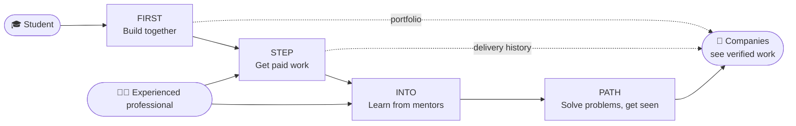

<div align="center">

# 4-Product One Community

### Experience before graduation. Proof before the diploma.

**An open-source, four-product career ecosystem that connects university students with real projects, real clients and experienced professionals.**

[](LICENSE)
[](#-open-source-and-transparency)
[](FIRST/backend/README.md)
[](FIRST/frontend/README.md)
[](CONTRIBUTING.md)

[Türkçe](README.md) · [Problem](#-the-problem-the-first-job-door-is-closing) · [Products](#-four-products-one-journey) · [Status](#-project-status-an-honest-summary) · [Contribute](#-contribute)

</div>

---

## 🎯 The problem: the "first job" door is closing

Much of the entry-level work — routine code, first drafts, basic analysis, simple design — can now be done in minutes with AI tools. Employers ask for "2+ years of experience", yet **the very door where that experience is earned** is getting narrower every year.

The pattern is the same across industries:

| | |
|---|---|
| 🎓 **New graduates** | They hold a degree but have no verifiable work. They aren't hired for lacking experience, and can't gain experience without being hired. |
| 🏫 **Universities** | Theory is strong; real systems, real teams and real client pressure sit outside the curriculum. |
| 🧑‍💼 **Experienced professionals** | Many want to pass on what they know, but there is no structured channel that values their time. |
| 🏢 **Companies** | They screen candidates on résumé claims and cannot see **what candidates have actually built**. |

> The problem is not a lack of talent. It is the lack of **a path to prove talent on real work**.

## 💡 The solution: put students inside the industry while they still study

**4-Product One Community** is an ecosystem of four connected products that takes a university student into real industry experience from day one:

1. **Students** build a *verifiable* work history on real projects, real systems and real teams before they graduate.
2. **Experienced professionals** earn income through mentoring while developing the next generation of their field.
3. **Companies** see new graduates through **the real work they delivered**, not résumé lines, and hire with less risk.
4. **Universities** strengthen their students' bridge to industry without changing their curriculum.

Everyone benefits because value comes from **a reinforcing loop, not a one-sided service**.

## 🧭 Four products, one journey



| Product | What it does | What students gain | Status |
|---|---|---|---|
| **[FIRST](FIRST/README.md)**<br/>*Future Innovators Research & Source Team* | Project and open-source community: share projects, form teams, contribute. | First real team experience and a public contribution history. | 🟢 **Working / deployed** |
| **[STEP](STEP/README.md)**<br/>*Student Talent Entry Platform* | Paid job marketplace for verified students, with payment protection and work tracking. | First client, first income, first review. | 🟡 **Built, preparing for launch** |
| **[INTO](INTO/README.md)**<br/>*Industry Navigation & Talent Orientation* | Paid and volunteer mentoring; urgent help and project mentoring. | Industry guidance, faster unblocking, career clarity. | 🔵 **Scope defined** |
| **[PATH](PATH/README.md)**<br/>*Problem Arena for Talent & Hiring* | Hackathon/datathon-style competitions on real company problems. | Proving skill on real problems and hiring visibility. | ⚪ **Idea stage** |

### The flywheel: how the products feed each other

- **FIRST → STEP:** People who build together can win paid work from visible contributions even without client history, and can bid as teams.
- **STEP → INTO:** When scope or delivery review is needed, mentor support can be attached.
- **INTO → FIRST:** Mentors discover students' open projects and give real feedback.
- **PATH → all:** Company problems make talent visible in a shared arena.
- **Shared account and reputation:** The four products target one user journey; completed work accumulates in a single profile.

## 🌟 Why this is different

- **Work, not just education:** Not simulations — real projects, real teams, real payments.
- **Evidence-first:** Candidates are defined by what they delivered, not what they claim. Companies see verified contributions and reviews.
- **Three-sided balance:** Students, experienced professionals and companies each find an economically meaningful place.
- **Designed for every field:** Starts with software; extends to design, data/AI, video, translation and content. Mentoring is not limited to software.
- **Security first:** Security, data consistency and robustness take priority over raw speed — authentication, payments and private media access are designed accordingly.
- **Open source:** Code, decisions and architecture are open to review and contribution.

## 📍 Project status (an honest summary)

This is not just a pitch deck — it is a **working codebase**, and what is and isn't done is stated plainly:

| Area | Status |
|---|---|
| **FIRST** — accounts/sessions, Google & GitHub sign-in, GitHub repo linking, project listings, applications/invitations, teams, task discovery, community feed, profiles/people discovery | ✅ Implemented and deployed |
| **STEP** — backend, web UI and Windows/macOS/Linux work-tracking client sources | ✅ Built and independently source-reviewed · ⏳ test/runtime and live payment-provider verification pending |
| **INTO** | 📝 Scope and flows defined; implementation is next |
| **PATH** | 💭 Idea recorded; format, scoring and prize model still undecided |

Detailed records: [FIRST decisions](FIRST/kararlar.md) · [STEP implementation status](STEP/uygulama-durumu.md) · [platform idea notes](platform-urun-fikirleri.md). *(Product documents are currently written in Turkish.)*

## 🏗️ Technology

| Layer | Choice |
|---|---|
| Backend | Python, Django, Django REST Framework |
| Data | PostgreSQL, Redis |
| Frontend | TypeScript, React, Next.js |
| Desktop tracking client (STEP) | Python, PySide6 (Windows / macOS / Linux) |
| Infrastructure | Docker (backend), Vercel (frontend) |
| Sign-in / integrations | Google and GitHub OAuth, GitHub App for selected-repository access |
| Payments (STEP) | Behind a provider with funded-milestone logic; separate sandbox and live environments |

Architecture decisions are recorded with their rationale: [FIRST technical decisions](FIRST/teknik-kararlar.md), [STEP technical decisions](STEP/teknik-kararlar.md).

## 📁 Repository layout

```text
.
├── FIRST/     Project and open-source community (backend, frontend, contracts, decisions)
├── STEP/      Student job marketplace (backend, frontend, desktop tracker)
├── INTO/      Mentoring (product scope)
├── PATH/      Competitions and problems (product scope)
├── .orchestrator/   Multi-product development management and verification tooling
├── AGENTS.md  Development protocol
└── platform-urun-fikirleri.md   Combined idea notes for the four products
```

## 🚀 Quick start (FIRST)

> See the [backend](FIRST/backend/README.md) and [frontend](FIRST/frontend/README.md) docs for full setup, environment variables and security notes.

```sh
git clone https://github.com/caglarkc/4-product-one-community.git
cd 4-product-one-community

# Backend: copy the example env file and fill in YOUR OWN values
cp FIRST/backend/.env.example FIRST/backend/.env
cd FIRST/backend
docker compose --env-file .env up -d --wait db redis
docker compose --env-file .env run --rm backend python manage.py migrate --noinput

# Frontend
cd ../frontend
cp .env.example .env.local
npm install
npm run dev
```

## 🔓 Open source and transparency

- **License:** [Apache License 2.0](LICENSE) — use, modify and distribute freely, with an explicit patent grant.
- **Transparent decisions:** Product and technical decisions live in the repo; "decided" and "implemented and verified" are marked separately.
- **Secrets:** Keys and passwords are never committed; only `.env.example` templates are shared. See [SECURITY.md](SECURITY.md).
- **Inclusive community:** The [Code of Conduct](CODE_OF_CONDUCT.md) applies to everyone.

## 🤝 Contribute

This project practises what it preaches: **real experience on a real project.**

- 🧑‍🎓 **Students:** start with small, well-defined work — docs, tests, UI, bug fixes. Contributions appear in your public history.
- 🧑‍💻 **Developers:** review the architecture, suggest security and performance improvements.
- 🧑‍💼 **Industry professionals:** give feedback on the mentoring model, verification and hiring flows.
- 🏢 **Companies:** get in touch to join a pilot, present a problem, or partner on graduate development.

Start here: [CONTRIBUTING.md](CONTRIBUTING.md).

## 🤲 Support and partnerships

Grant and funding support would accelerate:

- independent security audit of STEP, live payment-provider verification and student identity/email verification infrastructure,
- pilot programmes with universities and measurable impact reporting,
- development of the INTO mentoring platform and PATH competition infrastructure,
- accessibility, multilingual support and open-source community management.

For institutional partnerships, grants or pilots, reach out via GitHub: [@caglarkc](https://github.com/caglarkc).

## 📄 License

Released under the [Apache License 2.0](LICENSE). Copyright © 2026 Ali Çağlar Koçer and contributors.
