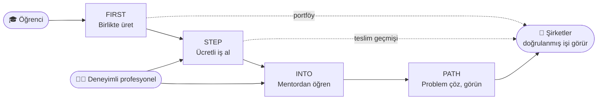

<div align="center">

# 4-Product One Community

### Mezuniyetten önce deneyim. Diplomadan önce kanıt.

**Üniversite öğrencilerini; gerçek projelerle, gerçek müşterilerle ve deneyimli profesyonellerle buluşturan, açık kaynaklı dört ürünlü kariyer ekosistemi.**

[](LICENSE)
[](#-açık-kaynak-ve-şeffaflık)
[](FIRST/backend/README.md)
[](FIRST/frontend/README.md)
[](CONTRIBUTING.md)

[English](README.en.md) · [Fikir ve vizyon](#-sorun-yapay-zekâ-çağında-ilk-iş-kapısı-daralıyor) · [Ürünler](#-dört-ürün-tek-yolculuk) · [Durum](#-proje-durumu-dürüst-özet) · [Katkı](#-katkı-ver)

</div>

---

## 🎯 Sorun: Yapay zekâ çağında "ilk iş" kapısı daralıyor

Giriş seviyesi görevlerin büyük kısmı — basit kod, ilk taslak, rutin analiz, temel tasarım — artık yapay zekâ araçlarıyla dakikalar içinde yapılabiliyor. Şirketler "en az 2 yıl deneyim" arıyor; ama **deneyim kazanılacak o ilk kapı** her geçen gün daha dar.

Sonuç, bütün sektörlerde aynı:

| | |
|---|---|
| 🎓 **Yeni mezunlar** | Diploma var, kanıtlanabilir iş yok. Deneyimsiz oldukları için işe alınmıyor; işe alınmadıkları için deneyim kazanamıyorlar. |
| 🏫 **Üniversiteler** | Teorik bilgi güçlü; gerçek sistemler, gerçek ekipler ve gerçek müşteri baskısı müfredatın dışında kalıyor. |
| 🧑‍💼 **Deneyimli profesyoneller** | Bilgi ve birikimlerini aktarmak isteyen çok kişi var; ama bunu yapılandıracak, değerini görecek bir kanal yok. |
| 🏢 **Şirketler** | Aday havuzunu özgeçmiş cümlelerinden değerlendirmek zorunda; adayın **gerçekte ne ürettiğini** göremiyor. |

> Sorun yetenek eksikliği değil. Sorun, yeteneğin **gerçek işte kendini kanıtlayacağı bir yolun** olmaması.

## 💡 Çözüm: Öğrenciyi daha okurken sektörün içine al

**4-Product One Community**, bir üniversite öğrencisini ilk gününden itibaren gerçek sektör deneyimine taşıyan, birbirine bağlı dört ürünlü bir ekosistemdir. Hedef net:

1. **Öğrenci** gerçek projelerde, gerçek sistemlerde ve gerçek ekiplerde çalışarak mezun olmadan önce *kanıtlanabilir* bir iş geçmişi oluşturur.
2. **Deneyimli profesyonel** mentorluk yaparak hem gelir elde eder hem de sektörüne yeni nesil yetiştirir.
3. **Şirket** yeni mezunları özgeçmişte değil, **yaptıkları gerçek işte** görür; riskini azaltarak işe alır.
4. **Üniversite** öğrencilerinin sektörle köprüsünü, kendi müfredatına dokunmadan güçlendirir.

Herkes kazanır; çünkü değer, **tek taraflı bir hizmetten değil, birbirini besleyen bir döngüden** doğar.

## 🧭 Dört ürün, tek yolculuk



| Ürün | Ne yapar? | Öğrenciye katkısı | Durum |
|---|---|---|---|
| **[FIRST](FIRST/README.md)**<br/>*Future Innovators Research & Source Team* | Proje ve açık kaynak topluluğu: proje paylaş, ekip kur, katkı ver. | İlk gerçek ekip deneyimi ve herkese açık katkı geçmişi. | 🟢 **Çalışıyor / yayında** |
| **[STEP](STEP/README.md)**<br/>*Student Talent Entry Platform* | Doğrulanmış öğrenciler için ücretli iş pazarı; ödeme güvencesi ve çalışma takibi. | İlk müşteri, ilk kazanç, ilk değerlendirme. | 🟡 **Geliştirildi, canlıya hazırlık** |
| **[INTO](INTO/README.md)**<br/>*Industry Navigation & Talent Orientation* | Ücretli/gönüllü mentorluk; acil destek ve proje mentorluğu. | Sektör yönlendirmesi, hızlı hata düzeltme, kariyer netliği. | 🔵 **Kapsam netleşti** |
| **[PATH](PATH/README.md)**<br/>*Problem Arena for Talent & Hiring* | Şirket problemleri üzerinde hackathon/datathon benzeri yarışmalar. | Gerçek problemde kendini kanıtlama, işe alım görünürlüğü. | ⚪ **Fikir aşaması** |

### Flywheel: ürünler birbirini nasıl besler?

- **FIRST → STEP:** Toplulukta birlikte üreten kişiler, müşteri geçmişi olmasa bile görünür katkılarıyla ücretli iş alabilir; takım olarak teklif verebilir.
- **STEP → INTO:** Kapsam ve teslim incelemesi gerektiğinde mentor desteği bağlanabilir.
- **INTO → FIRST:** Mentorlar öğrencilerin açık projelerini bulur ve onlara gerçek geri bildirim verir.
- **PATH → hepsi:** Şirket problemleri, yetenekleri ortak bir arenada görünür kılar.
- **Ortak hesap ve ortak itibar:** Dört ürün aynı kullanıcı yolculuğunu hedefler; yapılan iş tek bir profilde birikir.

## 🌟 Neden farklı?

- **"Eğitim"den öte "iş":** Simülasyon değil; gerçek proje, gerçek ekip, gerçek ödeme.
- **Kanıt odaklı:** Adayı iddiası değil, teslim ettiği işler tanımlar. Şirket doğrulanmış katkı ve değerlendirmeleri görür.
- **Üç taraflı denge:** Öğrenci, deneyimli profesyonel ve şirket aynı ekosistemde ekonomik olarak anlamlı bir yer bulur.
- **Her sektöre açık tasarım:** Yazılımla başlar; tasarım, veri/AI, video, çeviri ve içerik gibi alanları kapsar. Mentorluk yazılımla sınırlı değildir.
- **Güvenlik önce:** Ham hızdan önce güvenlik, veri tutarlılığı ve sağlamlık ilkesi; kimlik doğrulama, ödeme ve özel medya erişimi bu ilkeyle tasarlandı.
- **Açık kaynak:** Kod, kararlar ve mimari herkesin incelemesine ve katkısına açıktır.

## 📍 Proje durumu (dürüst özet)

Bu bir fikir sunumu değil, **çalışan kod tabanı** olan bir projedir; ancak ne bitti, ne bitmedi net biçimde belirtilir:

| Alan | Durum |
|---|---|
| **FIRST** — hesap/oturum, Google & GitHub girişi, GitHub repo bağlantısı, proje ilanı, başvuru/davet, ekipler, görev keşfi, topluluk akışı, profil/kişi keşfi | ✅ Uygulandı ve yayınlandı |
| **STEP** — backend, web arayüzü ve Windows/macOS/Linux çalışma takip istemcisi kaynakları | ✅ Geliştirildi, bağımsız kaynak incelemesinden geçti · ⏳ test/çalışma zamanı ve canlı ödeme sağlayıcı doğrulaması bekliyor |
| **INTO** | 📝 Ürün kapsamı ve akışlar tanımlı; uygulama sonraki aşama |
| **PATH** | 💭 Fikir kaydı; format, ölçme ve ödül modeli henüz belirlenmedi |

Ayrıntılı kayıtlar: [FIRST karar kayıtları](FIRST/kararlar.md) · [STEP uygulama durumu](STEP/uygulama-durumu.md) · [platform fikir notları](platform-urun-fikirleri.md).

## 🏗️ Teknoloji

| Katman | Seçim |
|---|---|
| Backend | Python, Django, Django REST Framework |
| Veri | PostgreSQL, Redis |
| Frontend | TypeScript, React, Next.js |
| Masaüstü takip istemcisi (STEP) | Python, PySide6 (Windows / macOS / Linux) |
| Altyapı | Docker (backend), Vercel (frontend) |
| Giriş / entegrasyon | Google ve GitHub OAuth, GitHub App ile seçili repo erişimi |
| Ödeme (STEP) | Sağlayıcı arkasında, çift taraflı emanet (escrow) mantığıyla; test/canlı ortam ayrımı |

Mimari ve teknoloji kararları ürün klasörlerinde gerekçeleriyle kayıtlıdır: [FIRST teknik kararlar](FIRST/teknik-kararlar.md), [STEP teknik kararlar](STEP/teknik-kararlar.md).

## 📁 Depo yapısı

```text
.
├── FIRST/     Proje ve açık kaynak topluluğu (backend, frontend, sözleşmeler, kararlar)
├── STEP/      Öğrenci iş pazarı (backend, frontend, masaüstü takip istemcisi)
├── INTO/      Mentorluk (ürün kapsamı)
├── PATH/      Yarışmalar ve problemler (ürün kapsamı)
├── .orchestrator/   Çoklu ürün geliştirme yönetimi ve doğrulama araçları
├── AGENTS.md  Geliştirme protokolü
└── platform-urun-fikirleri.md   Dört ürünün birleşik fikir notları
```

## 🚀 Hızlı başlangıç (FIRST)

> Ayrıntılı kurulum, ortam değişkenleri ve güvenlik notları için [backend](FIRST/backend/README.md) ve [frontend](FIRST/frontend/README.md) belgelerine bakın.

```sh
git clone https://github.com/caglarkc/4-product-one-community.git
cd 4-product-one-community

# Backend: örnek ortam dosyasını kopyalayıp KENDİ değerlerinizi girin
cp FIRST/backend/.env.example FIRST/backend/.env
cd FIRST/backend
docker compose --env-file .env up -d --wait db redis
docker compose --env-file .env run --rm backend python manage.py migrate --noinput

# Frontend
cd ../frontend
cp .env.example .env.local
npm install
npm run dev
```

Geliştirme düzenini doğrulamak için kökten:

```sh
node .orchestrator/bin/orchestrator.mjs verify-system
```

## 🔓 Açık kaynak ve şeffaflık

- **Lisans:** [Apache License 2.0](LICENSE). Kodu kullanabilir, değiştirebilir ve dağıtabilirsiniz; açık patent hakkı tanınır.
- **Şeffaf karar süreci:** Ürün ve teknik kararlar gerekçeleriyle depoda tutulur; "karar verildi" ile "uygulandı ve doğrulandı" ayrı işaretlenir.
- **Sır yönetimi:** Anahtarlar ve parolalar depoda tutulmaz; yalnızca `.env.example` şablonları paylaşılır. Bkz. [SECURITY.md](SECURITY.md).
- **Kapsayıcı topluluk:** [Davranış kuralları](CODE_OF_CONDUCT.md) herkes için geçerlidir.

## 🤝 Katkı ver

Bu proje, tam olarak çözmeye çalıştığı şeyi kendi içinde de yapar: **gerçek bir projede, gerçek deneyim.**

- 🧑‍🎓 **Öğrenciysen:** Dokümantasyon, test, arayüz, hata düzeltme gibi küçük, net işlerle başla. Katkıların herkese açık geçmişinde görünür.
- 🧑‍💻 **Geliştiriciysen:** Mimariyi incele, güvenlik/performans önerileri sun.
- 🧑‍💼 **Sektör profesyoneliysen:** Mentorluk modeli, doğrulama ve işe alım akışları hakkında geri bildirim ver.
- 🏢 **Şirketsen:** Pilot programa katılmak, problem sunmak veya yeni mezun yetiştirme sürecine ortak olmak için iletişime geç.

Başlamak için: [CONTRIBUTING.md](CONTRIBUTING.md).

## 🤲 Destek ve ortaklık

Proje, hibe ve fon desteğiyle şu alanlarda hızlanabilir:

- STEP için bağımsız güvenlik denetimi, canlı ödeme sağlayıcısı doğrulaması ve öğrenci kimlik/e-posta doğrulama altyapısı,
- Üniversitelerle pilot uygulamalar ve ölçülebilir etki raporlaması,
- INTO mentorluk platformunun ve PATH yarışma altyapısının geliştirilmesi,
- Erişilebilirlik, çok dillilik ve açık kaynak topluluk yönetimi.

Kurumsal ortaklık, hibe veya pilot görüşmeleri için GitHub üzerinden [@caglarkc](https://github.com/caglarkc) ile iletişime geçebilirsiniz.

## 📄 Lisans

[Apache License 2.0](LICENSE) altında yayımlanmıştır. Telif hakkı © 2026 Ali Çağlar Koçer ve katkıda bulunanlar.
